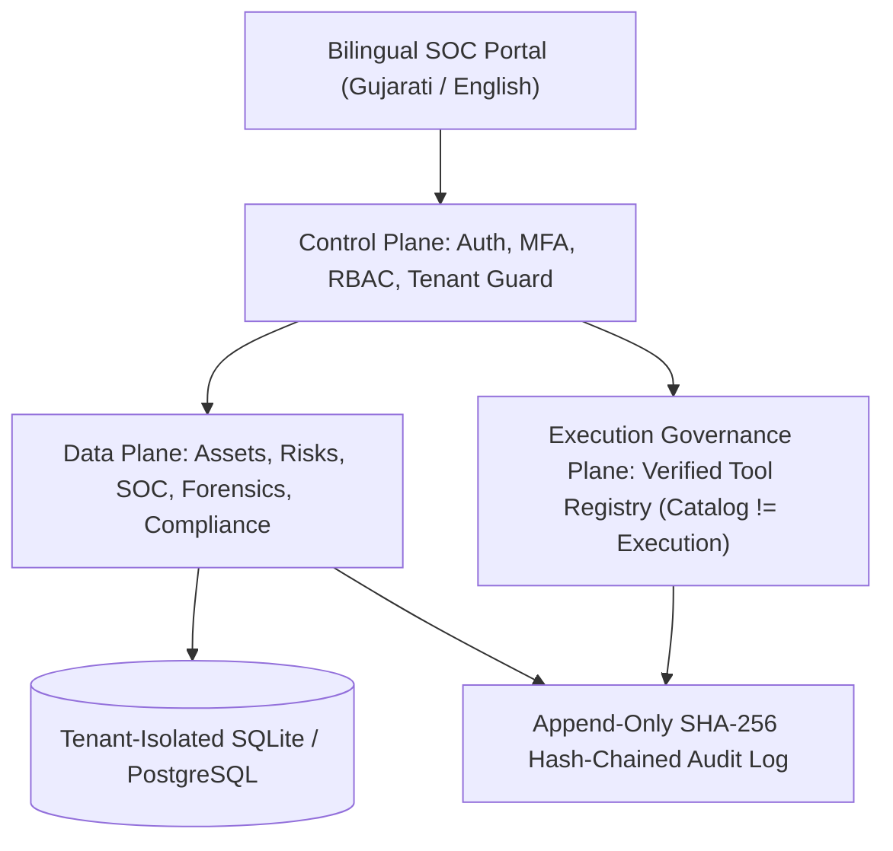

# Master System Architecture — VAJRAKAVACH 2070

**Founder & Developer:** Divyesh Bambhaniya

## 1. Architectural Pattern: Modular Monolith → Microservices
Phase 1–2 uses a **Modular Monolith** with strict internal package boundaries (`core/` vs `modules/`). This keeps deployment lightweight (Termux, single VM, Docker, Render) while preserving clean API and data boundaries for future Phase 4–5 microservice extraction (PostgreSQL, OpenSearch, Neo4j, Kafka, Kubernetes).

## 2. Three Security Planes

## 3. Evidence Integrity Model
- Original evidence payload/metadata is hashed at intake using **SHA-256** and **SHA-512**.
- Every custody transfer, review, or export appends an immutable row to `evidence_custody_events`.
- Analysis is performed on copies; original hashes can be re-verified on demand via API.

## 4. Multi-Tenant Isolation Model
- Every operational table carries a non-null `tenant_id` foreign key.
- Authenticated requests derive `tenant_id` strictly from the cryptographically signed session token — never trusting client-supplied `tenant_id` query parameters.
